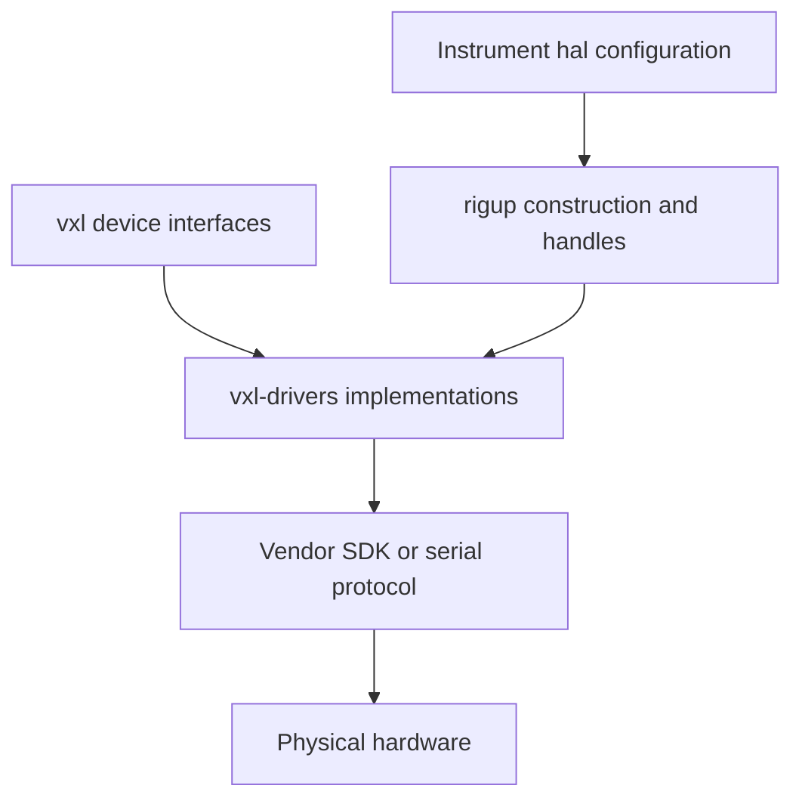

# vxl-drivers

**Connect Voxel's device interfaces to real microscope hardware.**

vxl-drivers contains the vendor-specific cameras, lasers, motion controllers, and related devices used by Voxel
instruments. The `vxl` package defines the device contracts, while [rigup](../rigup/) constructs the configured
devices and presents them through the same asynchronous handle API used for simulated hardware.

## Highlights

- **Configuration-selected hardware** — instrument configurations identify drivers by import path, without embedding
  vendor-specific construction in the instrument runtime.
- **Common device contracts** — physical cameras, lasers, power meters, and axes implement interfaces defined by `vxl`;
  specialized controllers such as AOTFs live in this package.
- **Shared-controller support** — hubs own serial buses or vendor connections and are injected into colocated device
  drivers by rigup.
- **Hardware-free application development** — core simulations live in `vxl`; legacy AOTF and laser simulations
  remain here alongside their driver interfaces.

## How the package fits



Application code normally controls a configured driver through a rigup `DeviceHandle`; it does not instantiate the
driver directly. This keeps local, subprocess-hosted, and remote devices on the same control surface.

## Configure hardware

Each entry in an instrument's `hal.devices` mapping names a driver `target` and its constructor `init` arguments.
rigup supplies the device UID and resolves references to other configured devices on the same node. For example, a
Tiger hub can own one controller connection shared by several axes:

```yaml
hal:
  devices:
    tiger_controller:
      target: vxl_drivers.tigerhub.TigerHub
      init: {box: COM3}

    x_axis:
      target: vxl_drivers.axes.asi.TigerLinearAxis
      init: {hub: tiger_controller, axis_label: x}
```

A hub and the devices that depend on it must run in the same process. See the [rigup README](../rigup/) for local,
subprocess, and remote-node placement.

> [!CAUTION]
> Constructing a hardware driver may immediately open a physical device. Confirm ports, addresses, limits, and laser
> safety controls before loading a real instrument configuration.

## Included integrations

These are concrete integrations present in the package. Actual operation also depends on compatible hardware,
firmware, operating-system drivers, and vendor runtimes.

### Cameras

| Hardware | Target | Python support |
| --- | --- | --- |
| Vieworks through Euresys eGrabber | `vxl_drivers.cameras.egrabber.VieworksCamera` | `egrabber-camera` extra |
| Hamamatsu DCAM cameras | `vxl_drivers.cameras.dcam.hamamatsu.HamamatsuCamera` | Bundled Python wrapper; native DCAM runtime required |
| PCO sCMOS cameras | `vxl_drivers.cameras.pco.PCOCamera` | `pco` package installed separately |
| Ximea cameras | `vxl_drivers.cameras.ximea.XimeaCamera` | `ximea-camera` extra |

### Lasers and AOTFs

A laser implements `vxl.devices.light.laser.Laser`. A line of an AOTF, or an AOM, implements
`vxl.devices.light.modulator.Modulator`. A box that several of them share is a hub, and each of them takes it as
`hub` in its `init`.

| Hardware | Target | Python support |
| --- | --- | --- |
| Coherent Genesis MX laser | `vxl_drivers.lasers.genesis_mx.GenesisMXLaser` | `coherent-laser` extra |
| MPB VFL laser | `vxl_drivers.lasers.mpb_vfl.MpbVflLaser` | Serial support included |
| Coherent OBIS LX/LS laser | `vxl_drivers.lasers.obis.laser.ObisLaser` | Serial support included; direct port or 1 channel of a hub |
| Coherent OBIS LaserBox or Remote | `vxl_drivers.lasers.obis.hub.ObisHub` | Serial support included |
| Cobolt Skyra line laser | `vxl_drivers.lasers.skyra.laser.SkyraLaser` | Serial support included; one line of a hub |
| Cobolt Skyra | `vxl_drivers.lasers.skyra.hub.SkyraHub` | Serial support included |
| Vortran Stradus laser | `vxl_drivers.lasers.stradus.StradusLaser` | Serial support included |
| Oxxius combiner | `vxl_drivers.lasers.oxxius.hub.OxxiusHub` | Serial support included |
| Oxxius LBX laser | `vxl_drivers.lasers.oxxius.lbx.OxxiusLBXLaser` | Serial support included |
| Oxxius LCX laser | `vxl_drivers.lasers.oxxius.lcx.OxxiusLCXLaser` | Serial support included |
| Oxxius LCX linked modulator | `vxl_drivers.lasers.oxxius.lcx.OxxiusLCXModulator` | The modulator of an LCX slot of an `OxxiusHub` |
| MPDS controller | `vxl_drivers.modulators.mpds.hub.MPDSHub` | Serial support included |
| MPDS line, as a modulator | `vxl_drivers.modulators.mpds.modulator.MPDSModulator` | One RF line of an `MPDSHub` |

The MPDS calibration CLI is `vxl-calibrate-mpds`; install the `mpds-calibration` extra for plotting.

Older laser implementations are retained under `vxl_drivers._legacy.lasers`. They report `laser_archived`, remain
accessible through `hal.devices`, and cannot be assigned as canonical illumination lasers.

| Legacy hardware | Target | Python support |
| --- | --- | --- |
| Vortran Stradus | `vxl_drivers._legacy.lasers.vortran_stradus.VortranStradus` | `vortran-laser` extra |
| Cobolt Skyra | `vxl_drivers._legacy.lasers.cobolt_skyra.CoboltSkyra` | `pycobolt-laser` extra |
| Coherent Genesis MX | `vxl_drivers._legacy.lasers.coherent.genesis_mx.GenesisMX` | `coherent-laser` extra |
| Coherent OBIS LX and LS | `vxl_drivers._legacy.lasers.coherent.obis.ObisLX`, `ObisLS` | `obis-laser` extra |
| MPB VFL | `vxl_drivers._legacy.lasers.mpb.vfl.MpbVfl` | Serial support included |
| Oxxius LBX and LCX | `vxl_drivers._legacy.lasers.oxxius.OxxiusLBX`, `OxxiusLCX` | Shared `vxl_drivers._legacy.lasers.oxxius.OxxiusHub` |
| AA Opto-Electronic MPDSnC | `vxl_drivers._legacy.aotf.mpds.MpdsAotf` | Included `aaopto-aotf` dependency |

### Power meters

| Hardware | Target | Python support |
| --- | --- | --- |
| Thorlabs PM100-series (SCPI/VISA) | `vxl_drivers.power_meters.thorlabs.ThorlabsPowerMeter` | `thorlabs-power-meter` extra; VISA backend required |

See the [driver module](src/vxl_drivers/power_meters/thorlabs.py) for setup notes and a configuration example.

### Motion control

| Hardware | Target | Python support |
| --- | --- | --- |
| ASI Tiger controller | `vxl_drivers.tigerhub.TigerHub` | Serial support included |
| ASI Tiger linear axis | `vxl_drivers.axes.asi.TigerLinearAxis` | Configured with a `TigerHub` |
| ASI Tiger XYZ stage | `vxl_drivers.axes.tiger_stage.TigerXYZStage` | 3 Tiger axes; `raster_scan()` for X/Y |
| ASI Tiger raster scan | `vxl_drivers.tigerhub.raster.TigerRasterScan` | Fast and slow axis letters on 1 card |
| Thorlabs MFF101 flip mount | `vxl_drivers.axes.thorlabs.MFF101` | `thorlabs` extra |

#### ASI Tiger linear axis: checks on the real stage

Written on 2026-11-20 from ASI's docs (docs.asiimaging.com) and tested against a fake controller. These need the real
stage before a run depends on them:

1. A sweep's pulses: is there one exactly at the stop, how many come for a span, and do they leave on the card's TTL
   output with no `TTL Y` setting?
2. After a sweep, does the stage go back to the start by itself (the retrace)?
3. The run-up (`run_up`): the driver estimates speed x (ramp / 2 + 50 ms) x 1.5 + 20 µm. Measure the real one.
4. Steps: 1 relative move on the ring buffer in TTL-triggered mode steps on every pulse. Check that it stops once the
   driver disarms it at the last step, and how close a pulse may come before the disarm.
5. `halt` stops the whole card (ASI has no per-axis halt): confirm which axes share a card on each rig.
6. The lowest speed an axis holds steady (`SPEED_RANGE_UM_S` guesses 1 µm/s).

To watch a Tiger stage's position live: `uv run python -m vxl_drivers.axes.tiger_stage --port COM3`.

The axis drivers below are on the legacy continuous axis (`vxl._legacy.devices.axes.continuous`), which only the
legacy app uses.

| Hardware | Target | Python support |
| --- | --- | --- |
| ASI Tiger linear axis | `vxl_drivers._legacy.axes.asi.TigerLinearAxis` | Configured with a `TigerHub` |
| Micronix MMC-100 controller | `vxl_drivers._legacy.axes.mmc.MMCHub` | Serial support included |
| Micronix MMC-100 linear axis | `vxl_drivers._legacy.axes.mmc.MMCLinearAxis` | Configured with an `MMCHub` |

## Install vendor support

Install only the optional dependency needed by the hardware being configured. From the Voxel workspace, for example:

```bash
uv sync --package vxl-drivers --extra egrabber-camera
```

Available extras are listed in [`pyproject.toml`](pyproject.toml). A Python extra may provide bindings without
installing the vendor's native runtime, device driver, firmware, or license; follow the corresponding vendor's
installation requirements as well.

## Develop and validate drivers

A driver implements the appropriate `vxl` device interface and exposes its public commands and properties through
rigup. It should keep vendor-specific types behind that boundary, serialize access to shared controller resources,
and release hardware deterministically from `close()`.

Run the hardware-independent checks from the workspace root:

```bash
uv sync --all-packages --all-groups
uv run ruff check drivers
uv run basedpyright drivers
uv run pytest drivers/tests
```

These checks cannot establish compatibility with a physical device or vendor runtime. Hardware validation should
name the exact model, firmware, connection, and exercised operations.


Low-level ASI Tiger command behavior is documented separately in the
[`tigerhub/ops` reference](src/vxl_drivers/tigerhub/ops/README.md).

vxl-drivers is part of the [Voxel](../) project and is available under its [MIT license](../LICENSE).
