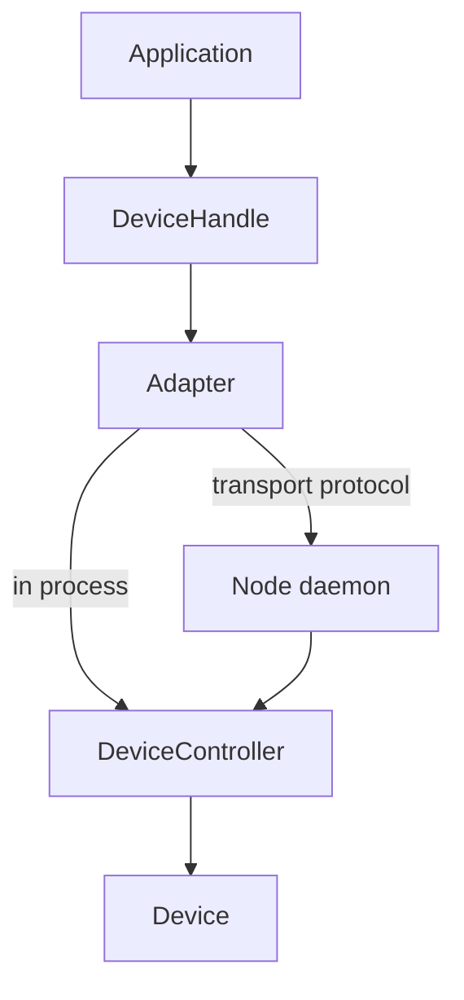

# rigur

**Control Python hardware through one asynchronous API, whether devices run locally, in a managed subprocess, or on
another machine.**

rigur is a hardware-control library for applications that need process isolation or distributed device hosting
without maintaining separate client APIs. Drivers expose commands and properties, a `Rig` constructs the requested
topology, and callers interact with every device through a `DeviceHandle`.

> [!WARNING]
> rigur is under active development. Its public API and wire protocol may change before the first stable release.

## Highlights

- **Location-transparent handles** — the same calls control in-process, subprocess, and remote devices.
- **Discoverable interfaces** — commands, properties, constraints, and presentation metadata are derived from the
  driver and represented by validated models.
- **Hardware-safe execution** — each device runs on its own thread and event loop, so 2 calls into 1 device never
  overlap, while separate devices remain independent. Calls from any other thread are refused.
- **Reactive properties** — streamed observations update one latest-successful cache shared by typed handle views and
  subscribers.
- **Explicit lifecycle** — `Rig` builds devices, reports partial build failures, and closes devices and managed
  processes deterministically.

## Define a device

A driver subclasses `Device` and says its kind in the class line. Only properties marked with `@prop` and methods
marked with `@query`, `@action` or `@failsafe` become part of its public interface. `@number`, `@integer` and `@choice`
add limits: every write is fitted to them, and every read carries them, such as `laser.power.maximum`.

```python
from rigur.device import Device, action, number, prop


class Laser(Device, kind="laser"):
    def __init__(self, uid: str) -> None:
        super().__init__(uid)
        self._power = 0.0
        self._enabled = False

    @number(minimum=0.0, maximum=100.0, step=0.1)
    @prop(label="Power", units="mW", stream="fast")
    def power(self) -> float:
        return self._power

    @power.setter
    def power(self, value: float) -> None:
        self._power = value

    @action(label="Enable")
    def enable(self) -> None:
        self._enabled = True
```

`stream="fast"` or `stream="slow"` asks the controller to poll the property at that tier's rate and publish changed
observations. The rates are the controller's: its class line can set them for a device kind, and a rig config's
`streaming:` can set them for 1 device. Streams suit live telemetry, not events that need lossless delivery.

An async command gives up its device at each `await`, so other calls, such as a failsafe `stop` during a move, can run
in between. Guard a read-modify-write that spans an `await` with an `asyncio.Lock` on the device.

A class is checked when it is defined, and all of its problems are reported at once: a driver keeps its base's command
arguments and intents, does not describe a base's property again or hide it, and every command must describe itself
as JSON Schema. [`examples/simulated_rig.py`](examples/simulated_rig.py) runs every feature on simulated devices.

## Build and use a rig

`RigConfig` is a Pydantic model; an application may construct it directly or validate configuration loaded from
YAML or another source. Each target is the import path of a `Device` or `Part` subclass; this one is in
[`examples/devices.py`](examples/devices.py), so run it from `examples/`.

```python
import asyncio

from rigur import DeviceConfig, RigConfig
from rigur.rig import Rig


async def main() -> None:
    laser_config = DeviceConfig(target="devices.SimulatedLaser", init={"max_power": 300.0}, defaults={"power": 5.0})
    rig = Rig(RigConfig(devices={"laser": laser_config}), name="example")

    await rig.open()
    try:
        laser = rig.devices["laser"]
        await laser.props.set(enabled=True, power=12.5)
        print(await laser.props.get_value("power"))
        await laser.call("output_off")
    finally:
        await rig.close()


asyncio.run(main())
```

`DeviceHandle.call()` returns the command value and raises when the operation fails. `run_command()`, batched
commands, and property operations expose `Result` models when the caller needs per-operation error handling.

Successful property reads, writes, and stream observations enter `handle.props.cache`. Subscribe to `handle.props`
for complete cache snapshots, or use `handle.props.property(name, parser)` in a typed handle subclass for one parsed,
subscribable property.

## Place devices and parts

A rig file lists the `parts` of the rig, the `devices` of the application process, and each other process under
`nodes` with its own `devices`. A device has a driver and runs in 1 process. A part has no driver: it is a `Part`
model that holds facts, such as the band of a filter, and it runs in no process.

```yaml
parts:
  combiner: {kind: combiner}
  BP525: {target: my_parts.Filter, band: [500, 550]}

devices:
  laser:
    target: my_devices.Laser
  filter_wheel:
    target: my_devices.FilterWheel
    init: {slots: {"0": BP525}}

nodes:
  isolated_camera:
    kind: subprocess
    devices:
      camera:
        target: my_devices.Camera

  motion_host:
    kind: remote
    address: tcp://192.168.1.20:5555
    devices:
      stage:
        target: my_devices.Stage
```

| Placement | Lifecycle | Communication |
| --- | --- | --- |
| Top-level device | Constructed and closed in the application process | Direct adapter; no serialization |
| Subprocess node | Spawned and terminated by `Rig` | ZeroMQ over a temporary IPC endpoint by default |
| Remote node | Supervised independently and claimed while the rig is open | ZeroMQ over configured TCP or IPC endpoints |

If `kind` is omitted, no address or a local-only address selects `subprocess`, and a non-local TCP address selects
`remote`. An explicit `kind` always wins. `RigConfig.all_devices` gives every device of the rig, in each process.

A part entry is the part's own fields. `target` names its class when it is not `rigur.Part`. A part is made when the
file is read, so a wrong value is reported at its field, such as `parts.BP525.band`. Each process gets every part of
the rig when it builds its devices.

Component UIDs and node ids use only ASCII letters, digits, `_` and `-`. A UID is unique across all devices and parts
of the rig. An `init` value may name a part, or another device in the same process, by UID: rigur passes the part or
the built device. Independent targets within a dependency layer can initialize in parallel; devices sharing a target
class initialize sequentially to protect SDKs with shared process state.

A device entry and a part may also hold `details`, information for people. Rigur does not read it, and a built device
does not get it.

### Composition lifecycle and access

Injected devices are borrowed: rigur owns their lifecycle. Each registered device has its own thread; calls made
directly to an injected object from another thread are refused. Shared hardware locks can serialize transactions,
but do not coordinate a composition's saved settings with direct component writes.

A node closes devices in the reverse of the order it built them, so a composition closes before the components it
was given.

## Run a remote node

Start the daemon on the device host, using the node ID declared by the controlling rig:

```bash
rigur-node motion_host --address tcp://0.0.0.0:5555
```

The TCP RPC endpoint uses the configured port and the stream endpoint uses the following port, so this example needs
ports `5555` and `5556` available on the trusted LAN. The controlling rig sends the device build configuration after
connecting. A claim/release handshake prevents two rigs from controlling the daemon concurrently, but the current
transport does not provide authentication or encryption.

Node logs are forwarded into the controlling process's Python logging system. Log and device streams use a lossy
publish/subscribe channel so they cannot back-pressure hardware operations; commands and explicit property reads and
writes use the reliable request channel.

## Architecture



- `Device` is the synchronous, hardware-facing abstraction.
- `DeviceController` discovers the public interface, runs synchronous hardware calls, and publishes streams.
- An adapter provides the common asynchronous command, property, and subscription contract.
- `DeviceHandle` is the application-facing API; subclasses can add typed convenience methods and properties.
- `Rig` constructs nodes and devices from configuration and owns their runtime lifecycle.

The protocol uses Pydantic payload models and MessagePack serialization. Request/response and notification traffic
travels over a reliable DEALER/ROUTER channel; high-rate streams travel separately over PUB/SUB. Application code
should use handles rather than construct protocol frames directly.

## Known limitations

- Node log records sent in the moments right after a node opens can be lost: the broadcast channel drops messages
  until the subscription reaches the node.
- A remote node that dies is noticed only when a call times out. A subprocess node is noticed at once.
- On Windows, pyzmq warns at startup that it runs an extra selector thread. This is expected.
- After a write such as `laser.power = 5.0`, a type checker treats `laser.power` as the written value, so
  `laser.power.maximum` needs a fresh read to type check.
- Direct writes to a component while a composition that holds it is operating are not coordinated with the
  composition's own state.

## Develop rigur

From the Voxel workspace root:

```bash
uv sync --all-packages --all-groups
uv run ruff check rigur
uv run basedpyright rigur
uv run pytest rigur/tests
```

Use `uv run pytest rigur/tests -m "not slow"` to omit transport and subprocess integration tests.

Device implementations intended for Voxel live in [`vxl-drivers`](../drivers/) or alongside Voxel's vendor-neutral
device interfaces. rigur itself remains independent of microscope acquisition and user-interface concerns.

rigur is part of the [Voxel](../) project and is available under its [MIT license](../LICENSE).
